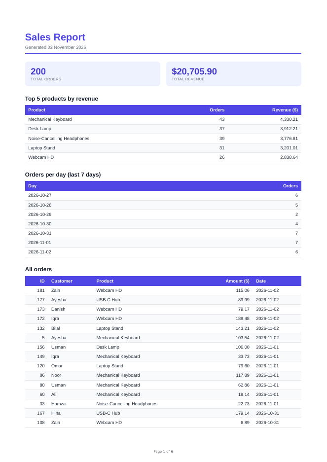

# PDF Report Generator

FlyRank Backend Track · Week 4 · Assignment A8.
A small FastAPI service that queries a SQLite database, renders the result into a real PDF with
headless Chromium (Playwright), stores the file on disk, and lets the client download it **by link**.

**Dataset:** Option A, "the little shop": 200 seeded random orders (6 products, amounts $5–$200, last 30 days).

## Pipeline

```
POST /reports -> SQL aggregation -> HTML template -> Playwright page.pdf() -> reports/<id>.pdf -> row in reports table
GET  /reports/<id>/file -> FileResponse (bytes stay on disk; JSON only carries the link)
```

## Run it

```bash
python -m venv .venv && source .venv/bin/activate      # Windows: .venv\Scripts\activate
pip install -r requirements.txt
playwright install chromium

python seed.py                       # creates report.db, inserts 200 orders (safe to run twice)
uvicorn main:app --port 8000         # start the API
```

Handy checkpoints:

```bash
python test_report_data.py           # Stage 2: prints the aggregation result as JSON
python make_test_pdf.py              # Stage 3: writes reports/test.pdf
```

## API

| Method | Path | Result |
|---|---|---|
| GET | `/health` | `{"status":"ok"}` |
| POST | `/reports` | `201` + `{id, created_at, file}`; `200` + the existing report if one was already generated today. Body `{"force": true}` always makes a new one |
| GET | `/reports` | list of all reports with links (extra) |
| GET | `/reports/{id}` | the record, or `404` |
| GET | `/reports/{id}/file` | the PDF (`application/pdf`), or `404` |

## Aggregation SQL (`report_data.py`)

```sql
-- two totals
SELECT COUNT(*) AS total_orders, COALESCE(SUM(amount), 0) AS total_revenue FROM orders;

-- top 5 products by revenue
SELECT product, COUNT(*) AS orders, ROUND(SUM(amount), 2) AS revenue
FROM orders
GROUP BY product
ORDER BY revenue DESC
LIMIT 5;

-- orders per day, last 7 days (days with zero orders are filled in Python)
SELECT created_at AS day, COUNT(*) AS orders
FROM orders
WHERE created_at >= ?        -- today minus 6 days
GROUP BY created_at
ORDER BY created_at;
```

## Proof: POST -> download

```
$ curl -si -X POST localhost:8000/reports
HTTP/1.1 201 Created
{"id":1,"created_at":"2026-11-02T16:41:34","file":"/reports/1/file"}

$ curl -o my-report.pdf localhost:8000/reports/1/file
$ file my-report.pdf
my-report.pdf: PDF document, version 1.4, 6 page(s)
```

Double-click proof (two POSTs fired at the same moment):

```
201  {"id":1,"created_at":"2026-11-02T16:41:34","file":"/reports/1/file"}
200  {"id":1,"created_at":"2026-11-02T16:41:34","file":"/reports/1/file"}
$ ls reports/*.pdf
reports/1.pdf                      # exactly one new file
```

`{"force": true}` returns `201` with a new id (`2`). An unknown id returns `404`.

Page 1 of a generated report:



Page-break handling: `tr { break-inside: avoid; }` keeps rows whole, and the table header sits in a
`<thead>` with `display: table-header-group`, so it repeats on every page (6 pages total).

## Stage 4: when would I move this out of the request?

Right now the POST takes about a second because the request waits for query, render and save. I would move it
into a background job once generation takes more than a few seconds (for example with 5,000+ rows or many
users at once), because long requests time out, tie up server workers, and leave the user waiting. The endpoint
should then return `202` + an id immediately, and the client polls `GET /reports/:id`.

## Stage 5: why the once-per-day check?

The check protects against a double-click or a retry creating two identical PDFs, and a lock makes the
check-then-create step atomic so two simultaneous requests can't both pass it. A real-world example where a
missing check costs money: a billing job that retries after a timeout and emails the same invoice (or charges
the card) twice, causing refunds and angry customers.
